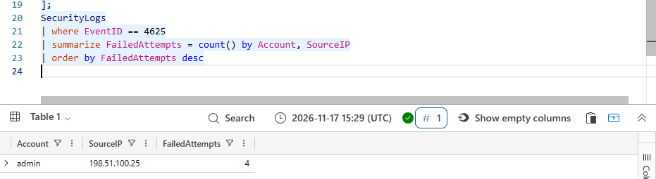
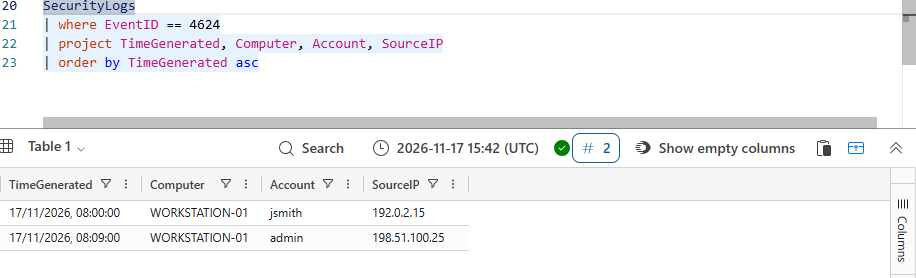
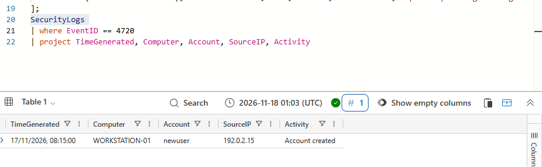

# Windows Security Log Analysis Using KQL

## Project Overview

This project demonstrates a beginner-level investigation of simulated Windows security events using Kusto Query Language (KQL) in Azure Data Explorer.

The aim is to practise identifying and reviewing potentially suspicious activity in security logs, including failed logon attempts, successful logons, account creation, and privileged activity.

The investigation follows a basic SOC analyst approach: review the available evidence, identify unusual activity, consider possible risks, and recommend appropriate next steps.

## Project Objectives

- Understand selected Windows Security Event IDs.
- Use KQL to filter and summarise security events.
- Identify repeated failed logon attempts.
- Review successful logons and account creation events.
- Examine events involving special privileges.
- Practise evidence-based investigation and documentation.

## Tools and Technologies

- Microsoft Azure Data Explorer
- Kusto Query Language (KQL)
- Synthetic Windows security event dataset

## Dataset Description

The project uses an eight-event synthetic dataset created for learning purposes.

The dataset contains the following fields:

| Field | Description |
|---|---|
| TimeGenerated | Date and time of the simulated event |
| Computer | Computer associated with the event |
| EventID | Windows Security Event ID |
| Account | Account associated with the event |
| SourceIP | Simulated source IP address |
| Activity | Brief description of the event |

These events were created within the KQL queries using an inline datatable() rather than imported from a live Windows endpoint or an actual log collection.

The IP addresses use reserved documentation ranges and do not represent real public IP addresses.

## Windows Event IDs Investigated

| Event ID | Description |
|---|---|
| 4624 | Successful logon |
| 4625 | Failed logon |
| 4720 | User account created |
| 4672 | Special privileges assigned to a new logon |

## Investigation and KQL Queries

The investigation focuses on four basic areas:

### 1. Failed Logon Analysis

Review failed logon events and count attempts by account and source IP address.

### 2. Successful Logon Analysis

Identify successful logons and review the associated timestamps, computers, accounts, and source IP addresses.

### 3. Account Creation Analysis

Identify account creation events and review the account and other available event details.

### 4. Privileged Activity Analysis

Review events associated with special privileges to identify activity that may require further investigation.

The executable KQL scripts are provided in the `queries` folder. Each script includes the synthetic dataset definition so it can be run independently.

## Investigation Screenshots

### 1. Dataset Overview

### 2. Failed Logon Analysis

### 3. Successful Logon Analysis

### 4. Account Creation Analysis

### 5. Privileged Activity Analysis

## Initial Findings

The review of the simulated events identified the following:

- Four failed logon attempts involving the `admin` account from `198.51.100.25`.
- A successful logon involving the `admin` account from the same simulated source IP address shortly after the failed attempts.
- A successful logon involving the `jsmith` account from `192.0.2.15`.
- A user account creation event involving the `newuser` account, associated with `192.0.2.15`.
- A special privileges event involving the `admin` account, also associated with `192.0.2.15`.

These observations identify activity worth reviewing, but they do not independently establish that an account was compromised or identify who performed each action.

## Analyst Assessment

The repeated failed logon attempts followed by a successful logon involving the same account and simulated source IP address may indicate a possible password-guessing or unauthorised access attempt.

The account creation and special privileges events also warrant further review.

However, the available dataset does not contain enough information to establish a direct relationship between these events or attribute them to a particular user.

A SOC analyst should validate the activity using additional logs and supporting evidence before reaching a conclusion.

## Recommendations

- Review the repeated failed logon attempts and subsequent successful logon.
- Verify whether the account activity was expected and authorised.
- Investigate the account creation event to establish whether it was approved.
- Review the context of the special privileges event.
- Escalate suspicious activity for further investigation where necessary.

## Skills Practised

- Basic KQL querying
- Security event identification
- Windows Security Event ID awareness
- Failed and successful logon analysis
- Basic account activity investigation
- Reviewing privileged activity
- Evidence-based security analysis
- Investigation documentation

## Lessons Learned

This project helped me become more comfortable writing basic KQL queries and using them to examine simulated Windows security events.

I learned how to filter events using Event IDs, count repeated failed logon attempts, and review successful logons, account creation and special privileges.

One thing that stood out to me was how a series of failed logons followed by a successful logon can raise suspicion. However, I also learned that this pattern alone does not prove an account was compromised.

I found the account creation and special privileges events particularly useful because they showed me how different types of security events can provide investigation leads. I also realised that the information available in a dataset determines how much an analyst can confidently conclude.

Overall, this exercise taught me to look beyond individual events, consider the surrounding evidence, and avoid making conclusions that the available data cannot support.

## Investigation Limitations

- The dataset is synthetic and contains only eight events.
- It is simplified and does not represent the full structure of native Windows Security logs.
- The IP addresses are reserved documentation addresses and are not real threat indicators.
- The account field identifies the account associated with an event; it does not necessarily identify the person who initiated the action.
- The available data does not establish whether the events are connected or whether an actual security incident occurred.
  
## Project Status

Completed as a beginner practical exercise using Azure Data Explorer and KQL.

This project is part of my ongoing development towards a career in cybersecurity and Security Operations Centre (SOC) analysis.
